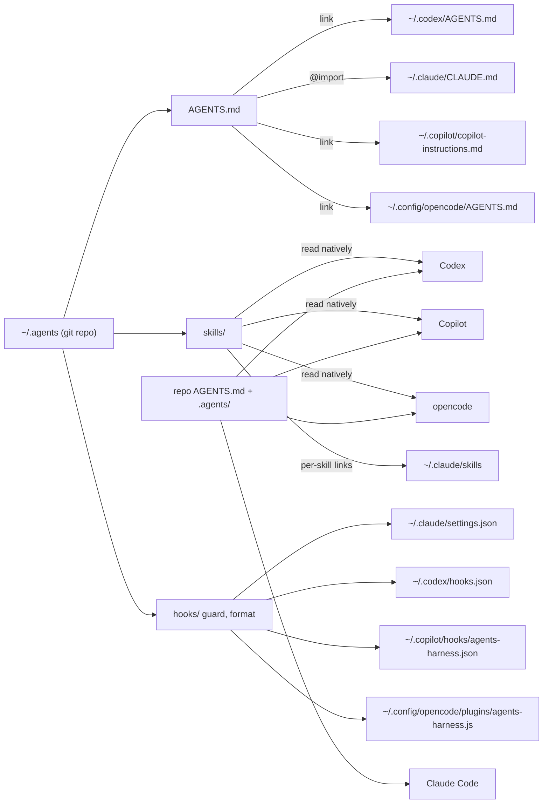
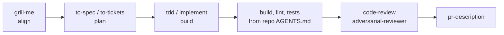

# Agent harness

One agent-agnostic setup for **Claude Code, Codex, GitHub Copilot and opencode**, on **Windows, macOS and Linux**.
Everything lives in `~/.agents`; each agent gets a thin link or a generated bridge to it.



## What each agent reads

| | Personal instructions | Personal skills | Hooks | Project instructions |
| --- | --- | --- | --- | --- |
| Claude Code | `~/.claude/CLAUDE.md`, a one-line import of `~/.agents/AGENTS.md` | `~/.claude/skills/*`, linked to `~/.agents/skills/*` | `~/.claude/settings.json` | repo `AGENTS.md` (v2.1.277+, when the repo has no `CLAUDE.md`) |
| Codex | `~/.codex/AGENTS.md`, linked | `~/.agents/skills`, natively | `~/.codex/hooks.json` | repo `AGENTS.md` |
| GitHub Copilot | `~/.copilot/copilot-instructions.md`, linked | `~/.agents/skills`, natively | `~/.copilot/hooks/agents-harness.json` | repo `AGENTS.md` (also `CLAUDE.md` and `.github/copilot-instructions.md`, combined) |
| opencode | `~/.config/opencode/AGENTS.md`, linked | `~/.agents/skills`, natively | `~/.config/opencode/plugins/agents-harness.js`, a plugin that runs the same hooks | repo `AGENTS.md` |

Claude Code and Copilot have no user-level `AGENTS.md`, which is why those two bridges exist. You never edit them; edit `~/.agents/AGENTS.md`.

On Windows, a link is a symlink when your account may create one (Developer Mode or admin). Otherwise skill folders become directory junctions, which need no rights, and the instruction files become copies the installer refreshes on every run.

## Layout

| Path | Purpose |
| --- | --- |
| `AGENTS.md` | Personal working agreement, the only instruction file you edit |
| `skills/` | 9 personal skills |
| mattpocock skills | 27 skills installed as the official plugin for each agent (MIT, [mattpocock/skills](https://github.com/mattpocock/skills)); self-updating, not copied here |
| `memory/` | Optional memory layer rules (ai-memory); OptMem's block comes from OptMem itself |
| `local/` | Per-machine choices and generated files (gitignored) |
| `hooks/guard.py` | Before each tool call: blocks force push, reset --hard, clean -f, branch -D, recursive deletes of root, home or drive paths (`rm`, `Remove-Item`, `rd /s`), secret files, and the graph CLI |
| `hooks/format.py` | After each edit: runs the repo's formatter on the edited files, only where the repo already uses one |
| `lib/install.py` | The installer, one implementation for every OS |
| `install.sh`, `install.ps1` | Launchers: macOS, Linux, WSL and Git Bash; Windows PowerShell |
| `adapters/` | Claude settings (permissions, no AI attribution), the CLAUDE.md bridge, and the opencode plugin template |
| `templates/project/` | Reference `AGENTS.md` the `setup-repo` skill starts from |
| `tests/` | Hook and installer tests, run in CI on Ubuntu, macOS and Windows |

## Setup

1. **Prerequisites.** Python 3.10 or later (the hooks run on it), git, and the agents you use: Claude Code v2.1.277 or later, Codex, GitHub Copilot CLI, opencode 1.18.29 or later. Node.js and pipx for the optional tools below. On Windows, Git for Windows is recommended (Claude Code runs hooks through Git Bash when present).

2. **Clone the harness into `~/.agents`.**
   ```bash
   git clone https://github.com/Caminare/agent-harness.git ~/.agents        # macOS, Linux, WSL
   ```
   ```powershell
   git clone https://github.com/Caminare/agent-harness.git "$HOME\.agents"  # Windows
   ```
   If `~/.agents` already exists (for example with Codex skills), clone elsewhere and merge its contents in. To customize, fork the repo first and clone your fork.

3. **Install for all agents.** Review with a dry run, then install:
   ```bash
   ~/.agents/install.sh --dry-run && ~/.agents/install.sh
   ```
   ```powershell
   & "$HOME\.agents\install.ps1" --dry-run; & "$HOME\.agents\install.ps1"
   ```
   On the first run it asks two questions and remembers the answers in `~/.agents/local/choices.json`: which [memory layer](#memory-layer) to use and which [prompt-cache mode](#prompt-cache). Pass `--memory none|ai-memory|optmem` and `--cache default|long|warm` to answer without prompts, or `--reconfigure` to be asked again.

   It links the instructions and skills for Claude Code, Codex, Copilot and opencode, writes their hook configuration (guard and format; for opencode a small plugin that calls the same hooks), merging into existing Claude and Codex settings without removing your entries, and installs the mattpocock skills in every agent it finds (`--no-plugins` skips that). opencode has no plugin marketplace, so it gets them as copies in `~/.config/opencode/skills` via `npx skills`; update them with `npx skills update --global`. Replaced files go to `~/.agents-backup/`.

4. **Trust the hooks and restart.** Codex: `/hooks`, trust the two harness hooks. Restart Claude Code, Copilot and opencode; check `/hooks` in Claude Code.

5. **Remove what is replaced.** `claude plugin uninstall caveman@caveman`, plus its Codex skill folder if you added one. Delete mattpocock skills you once copied by hand (`npx skills add`); the installer warns about them.

6. **MCP servers.** Atlassian everywhere, Playwright only where needed:
   ```bash
   claude mcp add --transport http atlassian --scope user https://mcp.atlassian.com/v2/mcp
   codex mcp add atlassian --url https://mcp.atlassian.com/v2/mcp && codex mcp login atlassian
   claude mcp add --transport stdio --scope project playwright -- npx -y @playwright/mcp@<pinned-version>
   ```
   In Copilot CLI, add the same Atlassian URL with `/mcp add`; in opencode, with `opencode mcp add`. Log in to Atlassian via `/mcp` in each agent.

7. **Code graph**, per repository:
   ```bash
   pipx install code-review-graph
   code-review-graph install --platform claude-code
   code-review-graph install --platform codex
   code-review-graph install --platform copilot-cli
   ```
   Then ask the agent to run `build_or_update_graph_tool` once.

8. **RTK.** Install it (`brew install rtk-ai/tap/rtk`, `winget install rtk-ai.rtk`), then `rtk init -g`, `rtk init -g --codex` and `rtk init -g --copilot`. Run `git -C ~/.agents diff`; keep one RTK block and commit.

9. **Memory layer**, if you chose one (see [Memory layer](#memory-layer)). OptMem needs nothing more. For ai-memory, inspect and run its installer, then `ai-memory setup --yes --agent claude-code --agent codex --agent copilot-cli --agent opencode` (drop the agents you do not use). For opencode it runs `opencode --version` to pick the plugin dialect, so opencode must be on your PATH. Run `git -C ~/.agents diff` again and commit what is intended.

10. **Repositories (optional, no install step).** Everything above already applies in every repo. To add project facts to one, open it in any agent and run the `setup-repo` skill (`/setup-repo` in Claude Code, Copilot and opencode, `$setup-repo` in Codex). The agent reads the code, drafts `AGENTS.md` with the repo's real build and test commands (each run once to confirm it works), migrates any project `CLAUDE.md` or `.github/copilot-instructions.md`, and waits for your approval before writing. It then offers `setup-matt-pocock-skills`, which configures the issue tracker, labels and docs layout that `to-spec`, `to-tickets` and `triage` use.

11. **Check the setup.**
    1. Each agent reports both `~/.agents/AGENTS.md` and the repo `AGENTS.md` when asked "Summarize the current instructions" (`/context` in Claude Code, `/instructions` in Copilot).
    2. The skills list (`/skills`, or `$` in Codex) shows your 9 skills plus the mattpocock ones (`tdd`, `grill-me`, `to-spec`, ...).
    3. Asking any agent to `git push --force` is blocked.
    4. `python -m unittest discover -s ~/.agents/tests` passes.

## Memory layer

Pick one, or none. The rules for the chosen layer are added to what every agent loads; `AGENTS.md` itself stays layer-free.

| | ai-memory | OptMem | none |
| --- | --- | --- | --- |
| What it is | A memory service with hooks, MCP tools and automatic same-repo handoffs ([akitaonrails/ai-memory](https://github.com/akitaonrails/ai-memory)) | One Python script and a 426-token prompt; the agent runs `memo wake` at start and `memo note` as it works ([VictorTaelin/OptMem](https://github.com/VictorTaelin/OptMem)) | Nothing |
| Installed by | You (step 9) | The harness installer | |
| Stored in | ai-memory's own store | `~/.optmem/memory` (append-only; `MEMORY_DIR` moves it) | |
| Choose it when | You want automatic capture and handoffs across agents and repos | You want something small you can read in five minutes | You do not want memory |

How it reaches each agent: Claude Code imports `~/.agents/local/memory.md` next to `AGENTS.md`. Codex, Copilot and opencode load a generated `~/.agents/local/AGENTS.md` (your `AGENTS.md` plus the layer), so with a layer chosen, run the installer again after editing `AGENTS.md`.

OptMem has no license file, so the harness does not copy it. The installer downloads one pinned commit, checks its SHA-256, and runs `memo init`, which never touches existing memories; the rules block is the one `memo init` prints. To update OptMem later, run its own installer. Switching layers never deletes memories.

## Prompt cache

Agents re-send the whole conversation each turn, and the provider's prompt cache bills the unchanged part at a fraction of the price, but only while the cache is alive. After an idle gap longer than its lifetime, the next turn pays full price for everything. `--cache` picks one of three modes:

| | `default` | `long` | `warm` |
| --- | --- | --- | --- |
| Claude Code | Subscription: 1 hour for the main conversation; API key: 5 minutes | `promptCacheTtl: "1h"` in `~/.claude/settings.json` (v2.1.242+), so API keys and usage credits get 1 hour too | No warming feature; nothing changes |
| opencode (2.x) | Each provider's default (5 minutes on Anthropic) | `settings.cache.ttl`: `1h` for Anthropic, `12h` for OpenAI | `"warming": true`: while you pause, it re-sends the context about every 4.5 minutes for up to 30 minutes |
| Codex | Provider-managed | No client setting | No client setting |
| GitHub Copilot | Provider-managed | No client setting | No client setting |

Trade-offs: a 1-hour Anthropic cache write costs 2x the input price instead of 1.25x, and a 12-hour OpenAI write 2.5x, so `long` pays off when you often pause for more than 5 minutes and loses on short, continuous bursts. `warm` sends real requests that cost tokens and count against rate limits. Pick one; warming does nothing for a cache that already outlives the 30-minute window. The installer writes opencode settings only into `opencode.json`; with an `opencode.jsonc` it prints the lines to add. Undoing a mode removes only the values the installer set.

## Save tokens with cheaper subagents

Run the main session on a strong model and hand bounded, low-judgement work to a subagent on a small model. The subagent burns its tokens at the small model's price and returns only a summary to the main context.

1. **Good fits:** reading or summarizing large text (logs, long docs, transcripts, big diffs); searching and mapping a codebase; implementing a well-defined ticket or spec with clear tests; small mechanical edits (renames, boilerplate, formatting, test scaffolding).
2. **Keep on the main model:** design and planning, subtle debugging, security-sensitive changes, reviews you rely on, and anything where the subagent would need most of your conversation to do it right.
3. **Ask for it explicitly:** "use a Haiku subagent to summarize these logs", "have a cheap subagent implement ticket 3 and run its tests".

How to set it up in each agent:

| Agent | Default model for subagents | A named cheap subagent |
| --- | --- | --- |
| Claude Code | `"env": {"CLAUDE_CODE_SUBAGENT_MODEL": "haiku"}` in `~/.claude/settings.json` (a model Claude picks when it spawns, or one in the agent's file, still wins) | `~/.claude/agents/<name>.md` with `model: haiku` in the frontmatter |
| Codex | `[agents]` in `~/.codex/config.toml`: `default_subagent_model = "<a smaller model>"`, `default_subagent_reasoning_effort = "low"` | A role under `[agents.<name>]` with its own `config_file` |
| opencode | Override the built-ins: `"agents": {"general": {"model": "<provider/small-model>"}, "explore": {"model": "<provider/small-model>"}}` | `~/.config/opencode/agents/<name>.md` with `mode: subagent` and `model: <provider/small-model>` |
| GitHub Copilot | No global setting | `~/.copilot/agents/<name>.agent.md` with `model: <model>` in the frontmatter |

Notes: on Claude Code, subagents get a 5-minute cache even on a subscription, which suits short tasks. A subagent starts with an empty context, so give it the file paths and the exact goal. With OptMem, subagents must not run `memo`; the OptMem rules tell the agent to say so when it spawns one.

## Daily use and maintenance

1. Edit only files in `~/.agents` and repo `AGENTS.md` files, and commit each change with a one-line reason. The ratchet: a mistake seen twice becomes a line in AGENTS.md; a rule that must never break becomes a hook.
2. After pulling updates on any machine, or after editing `AGENTS.md` with a memory layer chosen, run the installer again; new skills are linked, old links removed, and Windows copies refreshed. Repositories need nothing.
3. Run `/doctor prompt-audit` in Claude Code now and then to catch contradictions.

## Workflow at a glance



`AGENTS.md` lists which skill to use where the personal and mattpocock skills overlap (PR descriptions, bugs, reviews, handoffs, repo setup).

## Known limits

1. Hooks are guardrails, not a sandbox. Use each agent's sandbox for real isolation.
2. CI runs the rendered hook commands through sh, bash, PowerShell and cmd. The opencode plugin is loaded in Node and exercised against fake contexts for both opencode plugin APIs. What CI cannot run is each agent itself: Codex's Windows hook shell, Copilot's tool names and opencode's hook payloads are taken from their documentation and published types, so the first session in each agent is the real check.
3. `context: fork` and `disable-model-invocation` are Claude Code fields. Codex, Copilot and opencode run forked skills inline (opencode does honor `disable-model-invocation`); Codex gets the manual-only policy for the strict review and `setup-repo` through `agents/openai.yaml`.
4. CI checks the memory layer with a stand-in for OptMem's script and the cache modes with a fake opencode; the real OptMem was checked by hand on Linux only.
5. Copilot CLI contains an unreleased 1-hour cache flag that GitHub controls; there is no user setting yet.
6. opencode also reads `~/.claude/skills`, so it sees the harness skills twice; both entries point at the same files and opencode keeps one.
