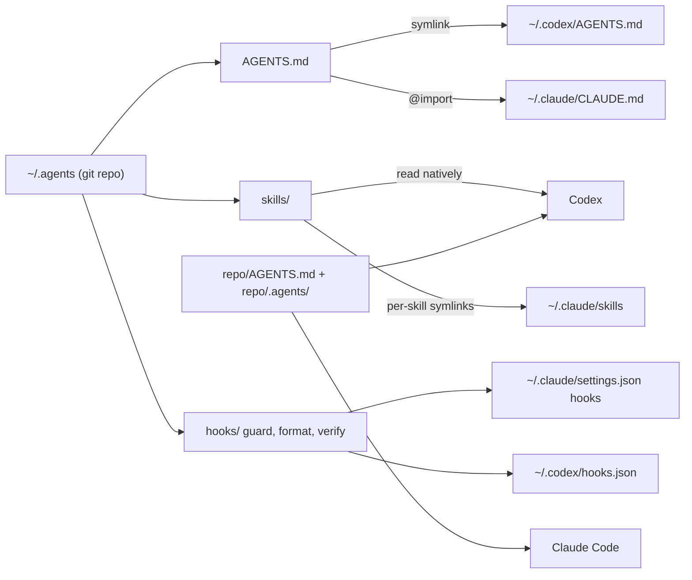

# Agent harness

One agent-agnostic setup for Claude Code and Codex (and any agent that reads AGENTS.md).
Everything lives in `~/.agents`; each agent gets a thin link to it.



Why one bridge file remains: Claude Code reads a project `AGENTS.md` natively (v2.1.277+), but at user level it only reads `~/.claude/CLAUDE.md`. That file is generated and contains a single import of `~/.agents/AGENTS.md`. Projects have no CLAUDE.md at all.

## Layout

| Path | Purpose |
| --- | --- |
| `AGENTS.md` | Personal working agreement, the only instruction file you edit |
| `skills/` | 10 personal skills (Codex reads them here; Claude through symlinks) |
| `hooks/guard.py` | PreToolUse: blocks force push, reset --hard, clean -f, branch -D, recursive rm on root or home, secret files, graph CLI |
| `hooks/format.py` | PostToolUse: formats edited files (repo's `.agents/format.sh`, or dart, prettier, csharpier where the repo opts in) and arms the verify loop |
| `hooks/verify.py` | Stop: runs the repo's `.agents/verify.sh` before the agent may finish, after it edited files |
| `adapters/` | Claude settings (permissions, hooks, no AI attribution) and Codex hooks.json |
| `templates/project/` | Reference `AGENTS.md` and `.agents/verify.sh` the `setup-repo` skill starts from |
| `install.sh` | One-time machine setup; idempotent, `--dry-run`, backups in `~/.agents-backup/` |
| `tests/test_hooks.sh` | 78 hook tests with Claude and Codex payloads |

## Setup

1. **Prerequisites.** Claude Code v2.1.277 or later (`claude --version`), Codex, git, python3, Node.js, pipx.

2. **Clone the harness into `~/.agents`.**
   ```bash
   git clone https://github.com/Caminare/agent-harness.git ~/.agents
   ```
   If `~/.agents` already exists (for example with Codex skills), clone elsewhere and merge its contents in. To customize, fork the repo first and clone your fork.

3. **Install for both agents.** `~/.agents/install.sh --dry-run` to review, then `~/.agents/install.sh`. It links `~/.codex/AGENTS.md`, writes the Claude bridge (keeps `@RTK.md` if present), links the skills, and merges permissions and hooks into existing settings without removing anything. Replaced files go to `~/.agents-backup/`.

4. **Trust the hooks.** Codex: `/hooks`, trust the three harness hooks. Claude Code: restart and check `/hooks`.

5. **Remove what is replaced.** `claude plugin uninstall caveman@caveman`, plus its Codex skill folder if you added one. Archive the old Global Claude.MD and PR Description pages. Matt Pocock's skills overlap `write-plan`: keep one approach.

6. **MCP servers.**
   ```bash
   claude mcp add --transport http atlassian --scope user https://mcp.atlassian.com/v2/mcp
   codex mcp add atlassian --url https://mcp.atlassian.com/v2/mcp && codex mcp login atlassian
   # inside a repo that needs a browser:
   claude mcp add --transport stdio --scope project playwright -- npx -y @playwright/mcp@<pinned-version>
   ```
   Log in to Atlassian via `/mcp`.

7. **Code graph.**
   ```bash
   pipx install code-review-graph
   cd /path/to/repo && code-review-graph install --platform claude-code && code-review-graph install --platform codex
   ```
   Then ask the agent to run `build_or_update_graph_tool` once.

8. **RTK.** `brew install rtk-ai/tap/rtk`, then `rtk init -g` (Claude) and `rtk init -g --codex` (Codex). Run `git -C ~/.agents diff`; keep one RTK block and commit.

9. **ai-memory.** Inspect and run its installer, then `ai-memory setup --yes --agent claude-code --agent codex`. Run `git -C ~/.agents diff` again and commit what is intended.

10. **Repositories (optional, no install step).** Everything above already applies in every repo. To add project facts and a verification check to a repo, open it in either agent and run `/setup-repo` (Claude) or `$setup-repo` (Codex). The agent reads the code, drafts `AGENTS.md` and `.agents/verify.sh` with the repo's real commands, migrates any project `CLAUDE.md`, and waits for your approval before writing.

11. **Verify.**
    1. Claude `/context` lists both `AGENTS.md` files; Codex answers "Summarize the current instructions" with both.
    2. `/skills` (Claude) and `$` (Codex) show the 10 skills.
    3. Asking either agent to `git push --force` is blocked.
    4. In a repo with `.agents/verify.sh`, breaking a test and letting the agent finish sends it back with the failure.
    5. `bash ~/.agents/tests/test_hooks.sh` passes.

## Daily use and maintenance

1. Edit only files in `~/.agents` and repo `AGENTS.md` files, commit the change with a one-line reason. The ratchet: a mistake seen twice becomes a line in AGENTS.md; a rule that must never break becomes a hook.
2. `git -C ~/.agents pull && ~/.agents/install.sh` on each machine after updates; new skills are linked automatically. Repositories need nothing.
3. Run `/doctor prompt-audit` in Claude Code now and then to catch contradictions.

## Known limits

1. Hooks are guardrails, not a sandbox. Enable `/sandbox` in Claude Code and Codex's sandbox for real isolation.
2. The verify loop arms only after the agent edits through Edit, Write or apply_patch in that session, so your own uncommitted work never triggers it. Edits made purely through shell commands do not arm it either.
3. `context: fork` and `disable-model-invocation` are Claude Code fields. Codex gets the same manual-only policy for the strict review and `setup-repo` through `agents/openai.yaml` and runs forked skills inline.
