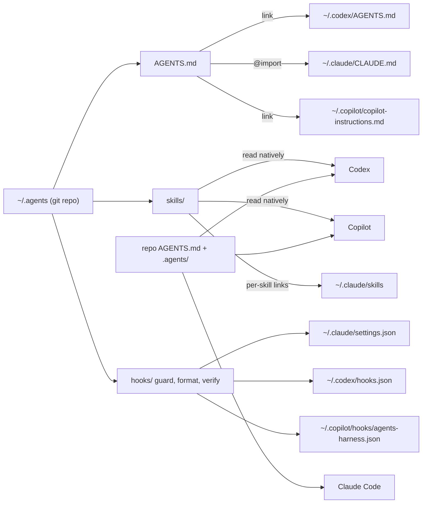
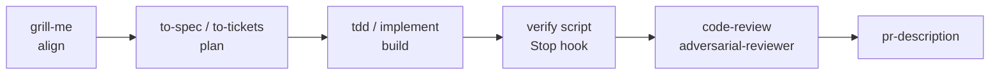

# Agent harness

One agent-agnostic setup for **Claude Code, Codex and GitHub Copilot**, on **Windows, macOS and Linux**.
Everything lives in `~/.agents`; each agent gets a thin link or a generated bridge to it.



## What each agent reads

| | Personal instructions | Personal skills | Hooks | Project instructions |
| --- | --- | --- | --- | --- |
| Claude Code | `~/.claude/CLAUDE.md`, a one-line import of `~/.agents/AGENTS.md` | `~/.claude/skills/*`, linked to `~/.agents/skills/*` | `~/.claude/settings.json` | repo `AGENTS.md` (v2.1.277+, when the repo has no `CLAUDE.md`) |
| Codex | `~/.codex/AGENTS.md`, linked | `~/.agents/skills`, natively | `~/.codex/hooks.json` | repo `AGENTS.md` |
| GitHub Copilot | `~/.copilot/copilot-instructions.md`, linked | `~/.agents/skills`, natively | `~/.copilot/hooks/agents-harness.json` | repo `AGENTS.md` (also `CLAUDE.md` and `.github/copilot-instructions.md`, combined) |

Claude Code and Copilot have no user-level `AGENTS.md`, which is why those two bridges exist. You never edit them; edit `~/.agents/AGENTS.md`.

On Windows, a link is a symlink when your account may create one (Developer Mode or admin). Otherwise skill folders become directory junctions, which need no rights, and the two instruction files become copies the installer refreshes on every run.

## Layout

| Path | Purpose |
| --- | --- |
| `AGENTS.md` | Personal working agreement, the only instruction file you edit |
| `skills/` | 9 personal skills |
| mattpocock skills | 27 skills installed as the official plugin for each agent (MIT, [mattpocock/skills](https://github.com/mattpocock/skills)); self-updating, not copied here |
| `hooks/guard.py` | Before each tool call: blocks force push, reset --hard, clean -f, branch -D, recursive deletes of root, home or drive paths (`rm`, `Remove-Item`, `rd /s`), secret files, and the graph CLI |
| `hooks/format.py` | After each edit: runs the repo's formatter on the edited files (only where the repo already uses one) and arms the verify loop |
| `hooks/verify.py` | When the agent tries to finish: runs the repo's `.agents/verify.sh` or `.ps1` and sends failures back |
| `lib/install.py` | The installer, one implementation for every OS |
| `install.sh`, `install.ps1` | Launchers: macOS, Linux, WSL and Git Bash; Windows PowerShell |
| `adapters/` | Claude settings (permissions, no AI attribution) and the CLAUDE.md bridge |
| `templates/project/` | Reference `AGENTS.md`, `verify.sh` and `verify.ps1` the `setup-repo` skill starts from |
| `tests/` | Hook and installer tests, run in CI on Ubuntu, macOS and Windows |

## Setup

1. **Prerequisites.** Python 3.10 or later (the hooks run on it), git, and the agents you use: Claude Code v2.1.277 or later, Codex, GitHub Copilot CLI. Node.js and pipx for the optional tools below. On Windows, Git for Windows is recommended (Claude Code runs hooks through Git Bash when present).

2. **Clone the harness into `~/.agents`.**
   ```bash
   git clone https://github.com/Caminare/agent-harness.git ~/.agents        # macOS, Linux, WSL
   ```
   ```powershell
   git clone https://github.com/Caminare/agent-harness.git "$HOME\.agents"  # Windows
   ```
   If `~/.agents` already exists (for example with Codex skills), clone elsewhere and merge its contents in. To customize, fork the repo first and clone your fork.

3. **Install for all agents.** Review with a dry run, then install:
   ```bash
   ~/.agents/install.sh --dry-run && ~/.agents/install.sh
   ```
   ```powershell
   & "$HOME\.agents\install.ps1" --dry-run; & "$HOME\.agents\install.ps1"
   ```
   It links the instructions and skills for Claude Code, Codex and Copilot, writes their hook configuration (merging into existing Claude and Codex settings without removing your entries), and installs the mattpocock skills plugin in every agent it finds (`--no-plugins` skips that). Replaced files go to `~/.agents-backup/`.

4. **Trust the hooks and restart.** Codex: `/hooks`, trust the three harness hooks. Restart Claude Code and Copilot; check `/hooks` in Claude Code.

5. **Remove what is replaced.** `claude plugin uninstall caveman@caveman`, plus its Codex skill folder if you added one. Delete mattpocock skills you once copied by hand (`npx skills add`); the installer warns about them.

6. **MCP servers.** Atlassian everywhere, Playwright only where needed:
   ```bash
   claude mcp add --transport http atlassian --scope user https://mcp.atlassian.com/v2/mcp
   codex mcp add atlassian --url https://mcp.atlassian.com/v2/mcp && codex mcp login atlassian
   claude mcp add --transport stdio --scope project playwright -- npx -y @playwright/mcp@<pinned-version>
   ```
   In Copilot CLI, add the same Atlassian URL with `/mcp add`. Log in to Atlassian via `/mcp` in each agent.

7. **Code graph**, per repository:
   ```bash
   pipx install code-review-graph
   code-review-graph install --platform claude-code
   code-review-graph install --platform codex
   code-review-graph install --platform copilot-cli
   ```
   Then ask the agent to run `build_or_update_graph_tool` once.

8. **RTK.** Install it (`brew install rtk-ai/tap/rtk`, `winget install rtk-ai.rtk`), then `rtk init -g`, `rtk init -g --codex` and `rtk init -g --copilot`. Run `git -C ~/.agents diff`; keep one RTK block and commit.

9. **ai-memory.** Inspect and run its installer, then `ai-memory setup --yes --agent claude-code --agent codex`. Run `git -C ~/.agents diff` again and commit what is intended.

10. **Repositories (optional, no install step).** Everything above already applies in every repo. To add project facts and a verification check to one, open it in any agent and run the `setup-repo` skill (`/setup-repo` in Claude Code and Copilot, `$setup-repo` in Codex). The agent reads the code, drafts `AGENTS.md` and `.agents/verify.sh` or `.ps1` with the repo's real commands, migrates any project `CLAUDE.md` or `.github/copilot-instructions.md`, and waits for your approval before writing. It then offers `setup-matt-pocock-skills`, which configures the issue tracker, labels and docs layout that `to-spec`, `to-tickets` and `triage` use.

11. **Verify.**
    1. Each agent reports both `~/.agents/AGENTS.md` and the repo `AGENTS.md` when asked "Summarize the current instructions" (`/context` in Claude Code, `/instructions` in Copilot).
    2. The skills list (`/skills`, or `$` in Codex) shows your 9 skills plus the mattpocock ones (`tdd`, `grill-me`, `to-spec`, ...).
    3. Asking any agent to `git push --force` is blocked.
    4. In a repo with a verify script, breaking a test and letting the agent finish sends it back with the failure.
    5. `python -m unittest discover -s ~/.agents/tests` passes.

## Daily use and maintenance

1. Edit only files in `~/.agents` and repo `AGENTS.md` files, and commit each change with a one-line reason. The ratchet: a mistake seen twice becomes a line in AGENTS.md; a rule that must never break becomes a hook.
2. After pulling updates on any machine, run the installer again; new skills are linked, old links removed, and Windows copies refreshed. Repositories need nothing.
3. Run `/doctor prompt-audit` in Claude Code now and then to catch contradictions.

## Workflow at a glance



`AGENTS.md` lists which skill to use where the personal and mattpocock skills overlap (PR descriptions, bugs, reviews, handoffs, repo setup).

## Known limits

1. Hooks are guardrails, not a sandbox. Use each agent's sandbox for real isolation.
2. The verify loop arms only after the agent edits files through its edit tools in that session, so your own uncommitted work never triggers it. Edits made purely through shell commands do not arm it either.
3. CI runs the rendered hook commands through sh, bash, PowerShell and cmd. What it cannot run is each agent itself: Codex's Windows hook shell and Copilot's tool names are taken from their documentation, so the first session in each agent is the real check.
4. `context: fork` and `disable-model-invocation` are Claude Code fields. Codex and Copilot run forked skills inline; Codex gets the manual-only policy for the strict review and `setup-repo` through `agents/openai.yaml`.
5. ai-memory currently covers Claude Code and Codex, not Copilot.
